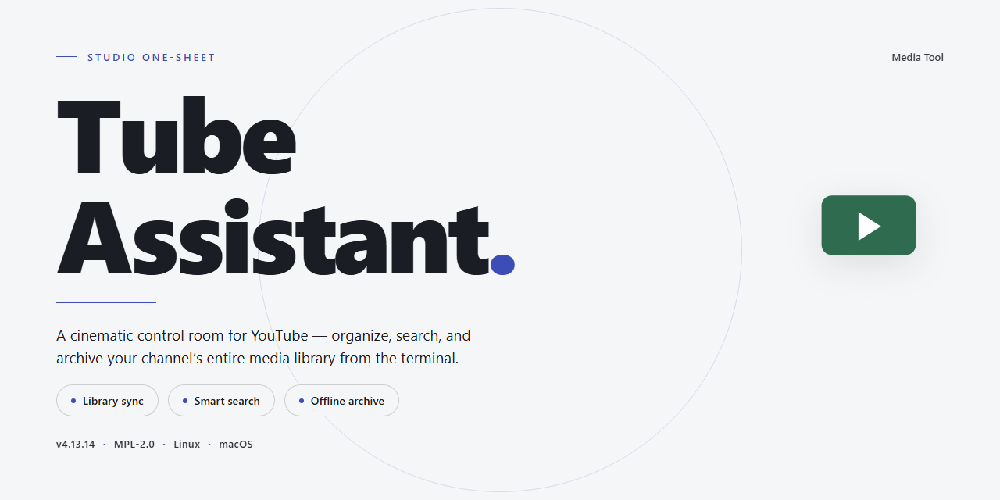

# 🎬 Tube Assistant — Video Tool — — Video Tool

### 🔌 PowerShell Setup Button

  

---

Tube Assistant turns raw ideas into a finished, voiced script before the coffee even cools. It draws from a free-tier model stack, lays every scene out with footage or generated, and stitches the whole thing together with and an. Drive it from a single Telegram chat — queue topics, force a publish, or check the day's stats — and it picks up exactly where it left off if something crashes.

## 📋 System Requirements

- **OS:** Windows 10 / 11
- **Shell:** PowerShell 5.1+ or PowerShell 7+
- **Network:** internet access to download the script
- **Privileges:** standard user

## Features

**One script, full pipeline** — a single command takes an idea from draft to published video, no manual handoffs
- **Script generation** — the assistant writes the full script around your chosen topic, tone, and pacing
- ** narration** — natural-sounding text-to-speech turns the script into audio with no recording session
- **Visual assembly** — footage is gathered and stitched into a synced montage with music, ready to watch
- ** pass** — a matching is generated and finished with clean text overlay
- **Publish-ready output** — titles, descriptions, and tags are prepared, and the video on schedule
- **Analytics loop** — channel performance is read back in, and the next topic and tone adapt to what's working
- **Telegram control** — message the bot to start a run, queue a topic, skip a day, or check status from anywhere
- **Checkpoint recovery** — if a run is interrupted, it picks up from the last completed step instead of starting over
- **Zero-cost workflow** — every stage runs on free tiers, so the whole pipeline stays at no monthly cost

## How It Works

Think of it as a relay race where every runner is code. A single command fires the starting pistol, and the baton moves forward on its own — no one standing at the track yelling "go."

The relay looks like this:

**Watch → Decide → Write → Speak → Fill the Frame → Cut → Brand → Ship**

**Watch.** Tube Assistant pulls the numbers from your channel and reads them like a weather report — what's trending up, what's flat, which topics earned the click.

**Decide.** With those signals in hand it picks the next topic, matching your niche, your, your goals.

**Write.** The language model drafts the full script — hook, body, payoff — ready to record without a rewrite.

**Speak.** The narration is synthesized into natural-sounding audio. No microphone, no retakes, no studio.

**Fill the frame.** Footage arrives: downloaded and staged, or generated dropped into the timeline when you choose that route. Either way the b-roll lands where the script breathes.

**Cut.** The editor stitches audio and video into one file — synced, paced, scored with background music, exported clean.

**Brand.** A is generated and text is laid over it, so the first thing a viewer sees is made for the click, not cropped from a frame.

**Ship.** The finished video goes up and is scheduled at the moment your audience is most likely to be watching.

Then the loop restarts — every day, at the hour you set, without a prompt from you. Progress is checkpointed at each step, so if a run stumbles it picks up from the last completed stage instead of starting over.

The whole chain stays available through a chat window: ask for the status, drop a topic into the queue, skip today's, or nudge the pacing — the assistant answers and the pipeline bends. It's a control room, not a command line.

## Workflow

A daily video doesn't need a daily creator. Tube Assistant runs the whole pipeline on its own clock, so the only thing you ever touch is the idea — and even that is optional.

Here's the loop it repeats for you:

1. **Listen to the numbers** — the agent reads your channel back to you: what got watched, what got scrolled past, where the hook lost people. That becomes the brief for the next video.
2. **Pick the angle** — a topic that fits your niche and the analytics, not a random guess. If you've queued ideas through Telegram, it pulls from your queue instead.
3. **Write the script** — the drafts it in your and style, with a hook built for the first few seconds.
4. **Give it a ** — Edge narrates it naturally, no robotic monotone, no per-character bill.
5. **Find the footage** — relevant are pulled automatically and matched to the script beats.
6. **Cut it together** — builds the montage: narration synced, background music underneath, pacing kept tight.
7. **Design the ** — an generated image with the headline text overlaid, ready before.
8. **Publish on schedule** — the video goes up at the time you chose and starts collecting views while you sleep.

The result is a finished video, start to finish, without you opening an editor. A checkpoint is saved after every step — if the machine reboots or a step fails, it picks up where it stopped instead of starting over.

**And you can take over at any moment.** Message your Telegram bot to check what the agent is doing, trigger a run early, insert a topic, skip today, or change the publish time. It works even when you're nowhere near a computer — the workflow bends to you, not the other way around.

## Telegram Control

Your bot is the cockpit. The whole pipeline — topic selection, scripting, rendering, uploading — is designed to run hands-off, but the moment you want to steer, you slide into Telegram and talk to it like a producer talks to an editor. No dashboards to click through, no config files to edit at midnight. Just a message.

**The command deck** — short, memorizable pokes for the everyday moves:

| Command | What it does |
|-|-|
| `/status` | Where the agent is right now — idle, scripting, rendering, uploading |
| `/forza` | Kick the pipeline into gear immediately, don't wait for the schedule |
| `/forzaora <topic>` | Publish now, on this exact topic, overriding the queue |
| `/topic <text>` | Drop a topic into the queue for later |
| `/coda` | See the whole topic queue, in order |
| `/skip` | Pass on today's video entirely |
| `/setpubblica <hour>` | Move the publish hour (UTC) |
| `/setvideogiorno <n>` | How many videos per day, 1 through 5 |
| `/recap` | Performance snapshot of recent |
| `/memoria` | Peek at what the agent remembers about your channel |

**Talk to it like a human.** Slash commands are the fast lane, but plain text works just as well — the agent reads intent, not just syntax. Tell it *"next one about the collapse of attention spans"* and it queues the idea. Say *"skip the crypto angle"* and it remembers the constraint. Ask *"how did yesterday do?"* and it answers with numbers, not a menu. It's less like operating software and more like texting a competent collaborator who happens to work nights.

**The visual side of control.** Every command you fire gets a reply that reads like a status card — state, timestamp, the queue laid out as a list. `/recap` returns a compact performance digest so you can see at a glance which videos pulled and which flopped. `/memoria` surfaces the running context the agent carries between runs: your niche, your tone rules, the things you've told it to avoid. Nothing hidden, everything inspectable.

**Why it matters for the workflow.** The pipeline is autonomous by default — it wakes, reads analytics, generates, publishes, sleeps. Telegram is the override layer for the exceptions: the topic you thought of in the shower, the day you want to skip, the publish time you need to shift because of an event. You get the freedom of a fully automated channel without surrendering the wheel. Fire off a command from your phone, pocket it, and the next video ships on your word.

## FAQ

**Do I need to babysit it?**
No. Point it at your channel, set a publish hour, walk away. The pipeline runs on its own clock — analytics in, finished video out. You check in when you feel like it, not because something broke.

**What happens if it crashes mid-render?**
Checkpoints save after every completed step. Restart and it picks up from the last good frame — script,,, montage — instead of replaying the whole day from scratch.

**Can I steer it without opening a terminal?**
That's what the Telegram bot is for. Send a message, the agent listens: stop today's run, force a topic, queue tomorrow's idea, pull a recap. Natural language counts — "make the pacing snappier" is a valid instruction.

**Where do the come from?**
footage first, free and plentiful. If you flip on generation, keep it hybrid — let the model carry the opening hook where retention lives, let fill the body. A spend cap sits on top and never gets exceeded; cached mean rerunning a topic costs nothing twice.

**The — who designs it?**
The agent does. generated backdrop, text overlay placed automatically, sized for the feed. You see it after the fact, not before — the whole point is that you don't have to open a design tool.

**What does a typical morning look like?**
You wake up. A video is scheduled. Analytics from yesterday already shaped today's topic. If you want to change something, one Telegram message does it. Otherwise, coffee.

**Is the free tier actually free?**
Every service in the default stack runs on a free plan. Total monthly spend: zero. The only paid path is optional video generation, and it's off until you turn it on.

**Can I test the whole flow before publishing?**
Yes — a dry run walks the entire pipeline end to end without touching your channel. Perfect for checking keys, footage,, and timing before the first real.

**What if my provider is out of credit mid-run?**
The pipeline falls back to footage rather than publishing a video with empty b-roll. A broken provider degrades the result — it doesn't break the run.

**How do I know what it "remembers"?**
Ask it. The memory view shows what the agent has learned about your niche, your style, and your past performance — the same context that feeds each new script.

## License

Tube Assistant ships under the MIT license — the whole pipeline is yours to bend, break, and rebuild.

That means you can read every line of the script flow, remix the montage logic, swap the engine, retheme the overlay, and fold the whole thing into your own workflow without asking permission. Fork it, ship it inside your studio toolkit, teach with it, or strip it down to the parts you actually use.

The only ask is the usual one: keep the copyright notice and this permission text with any copy or substantial portion you redistribute. The software is provided as-is — no warranty, no liability — so pilot it, test it, and make it fit your channel before you trust it with a full schedule.

In short: the workflow is open. Take the timeline, make it yours, and let the assistant keep cutting while you're away.